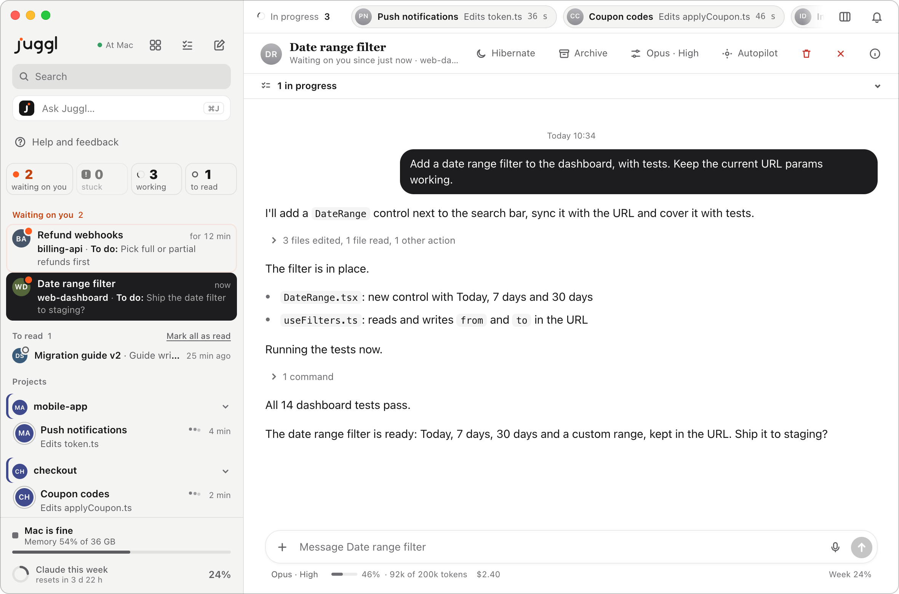
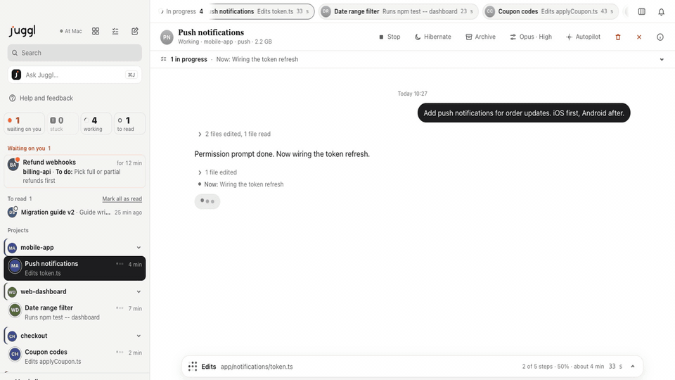
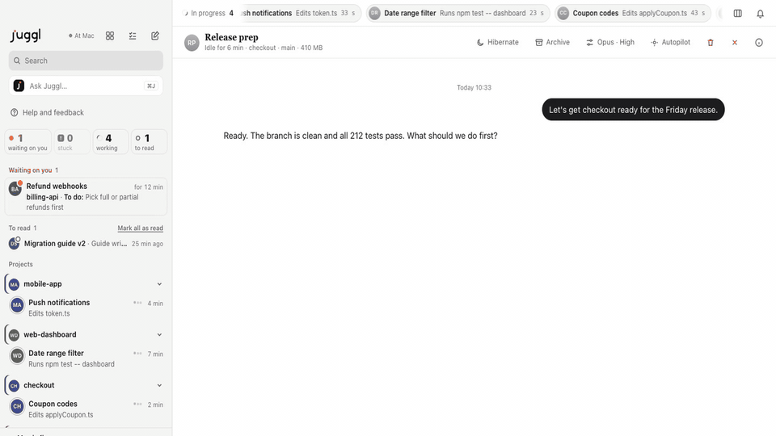
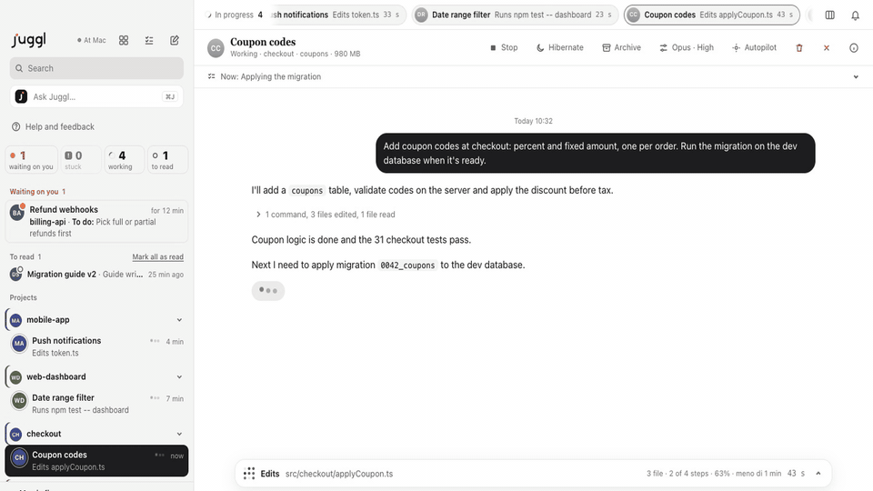
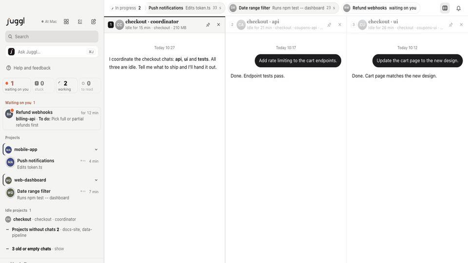
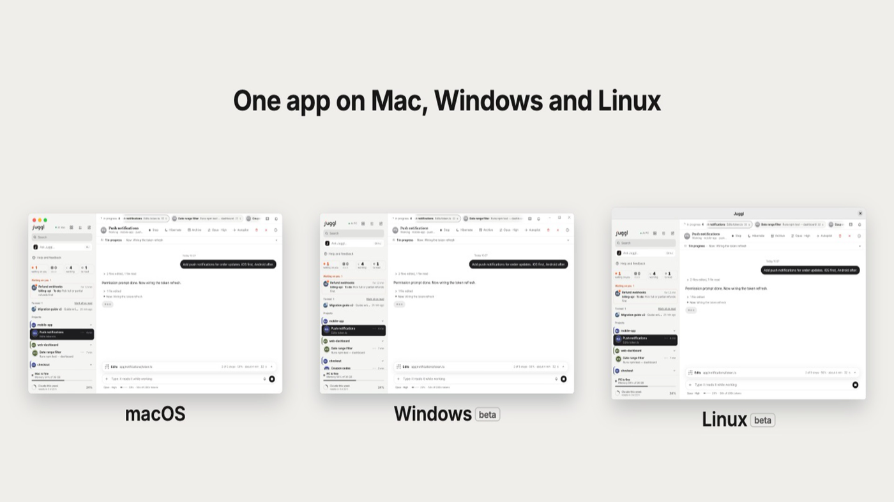

<p align="center">
  <picture>
    <source media="(prefers-color-scheme: dark)" srcset="docs/logo-dark.svg">
    
  </picture>
</p>

<p align="center">
  <b>All your Claude Code and Codex sessions in one window.</b><br>
  The ones waiting on you come first. Every request is tracked until it's done.
</p>

<p align="center">
  <a href="https://juggl.dev"></a>
  
  
  
  <a href="LICENSE.md"></a>
  
</p>

<p align="center">
  
</p>

---

## Why Juggl

Running ten or fifteen agent sessions at once is normal now: one per client, one per repo, one per experiment. The agents are fast. Keeping track of them is the slow part: which session stopped on a permission prompt an hour ago, which one finished and is waiting for an answer, which of the three things you asked in a long message never got done.

Juggl is a desktop app that sits on top of the Claude Code and Codex sessions you already run. It does not replace them and it does not run its own model. It reads the session files those tools write, and shows you what needs you, in order.

## What it does

<table>
<tr>
<td width="50%" valign="top">

### Waiting on you, first
Sessions that need an answer or a permission sit at the top with an orange dot. The Dock icon counts them. A session that finishes moves up by itself.

</td>
<td width="50%" valign="top">

### Every request tracked
Each thing you ask becomes an item on a list and stays there until an agent has done it. Three requests in one message become three items, ticked one at a time.

</td>
</tr>
<tr>
<td></td>
<td></td>
</tr>
<tr>
<td width="50%" valign="top">

### Permissions as buttons
Allow, Allow always in this chat, Deny. On the computer, or from the iPhone app with a notification when you are away from the desk.

</td>
<td width="50%" valign="top">

### One chat that coordinates
A coordinating chat can write to the other sessions, hand out work and report back when they are done. You talk to one chat instead of twelve.

</td>
</tr>
<tr>
<td></td>
<td></td>
</tr>
</table>

Also in the box: Claude Code and Codex in the same list, sub-chats grouped under their main chat, search across every message, archive and hibernate for idle sessions, dictation, and a usage view.

## How it works

```
 Claude Code  ──┐                       ┌──  Mac window
                ├─ session files ──▶  Juggl ──┤
 Codex        ──┘   + hooks            └──  iPhone app (local network or Tailscale)
```

- **Reads** the session files Claude Code (`~/.claude/projects`) and Codex already write.
- **Hooks**: Juggl adds Claude Code hooks to `~/.claude/settings.json` so it knows the moment a session waits. You can remove them from Settings.
- **Your login**: sessions run with your own Claude Code and Codex logins, on your computer.
- **Data** stays in `~/.juggl` on your computer. The only server Juggl talks to is juggl.dev, for the account, the license check and updates. No analytics, no tracking.

## Get it

Signed builds for macOS, and beta builds for Windows and Linux, are on **[juggl.dev](https://juggl.dev)**. Juggl is in a free private beta: request access there and you get an account with the download.

<p align="center"></p>

## Build from source

Requirements: Rust (stable), the Tauri 2 CLI (`cargo install tauri-cli`), and on macOS the Xcode command line tools. The interface is plain HTML and JavaScript in `ui/`, with no build step.

```bash
cd src-tauri
cargo tauri dev      # run
cargo tauri build    # package
```

On **Linux and Windows**, build the keeper helper once first: `tools/build-keeper.sh`. On Linux you also need the usual [Tauri system libraries](https://v2.tauri.app/start/prerequisites/#linux).

**Dictation is optional.** It uses [whisper.cpp](https://github.com/ggml-org/whisper.cpp), which is not in the repository. Without it Juggl builds and runs normally, only the microphone does not transcribe. To include it on macOS:

```bash
src-tauri/binaries/build-whisper.sh
cd src-tauri
cargo tauri dev --config tauri.dictation.conf.json     # or: cargo tauri build --config ...
```

**Checks**, the same ones CI runs on every pull request:

```bash
(cd src-tauri && cargo test --bin tavolo)
python3 tools/check-ui.py
for t in tools/test-*.mjs; do node "$t"; done
```

## FAQ

**Is Juggl open source?**
The source is public under the Functional Source License (FSL-1.1-ALv2). You can read it, run it, change it and use it at work. The one thing you cannot do is offer a product or service that competes with Juggl. Two years after each release, that release becomes Apache 2.0. More on the license: [fsl.software](https://fsl.software).

**What is not in this repository?**
The iPhone app, the account and license server behind juggl.dev, and the signing and update keys.

**Does Juggl send my code or my chats anywhere?**
No. Sessions run on your computer with your own accounts. Juggl reads their files locally and keeps its data in `~/.juggl`.

**Which agents does it support?**
Claude Code and Codex today.

## Contributing

Bug reports and ideas are welcome in Issues. Small pull requests too; for anything larger, open an Issue first so we can agree on the approach. See [CONTRIBUTING.md](CONTRIBUTING.md).
Security problems: please write to hello@juggl.dev, not to a public Issue ([SECURITY.md](SECURITY.md)).

## License

[FSL-1.1-ALv2](LICENSE.md), Copyright 2026 Davide Conte.

Juggl is an independent project, not affiliated with Anthropic or OpenAI. Claude Code and Codex are trademarks of their owners.
